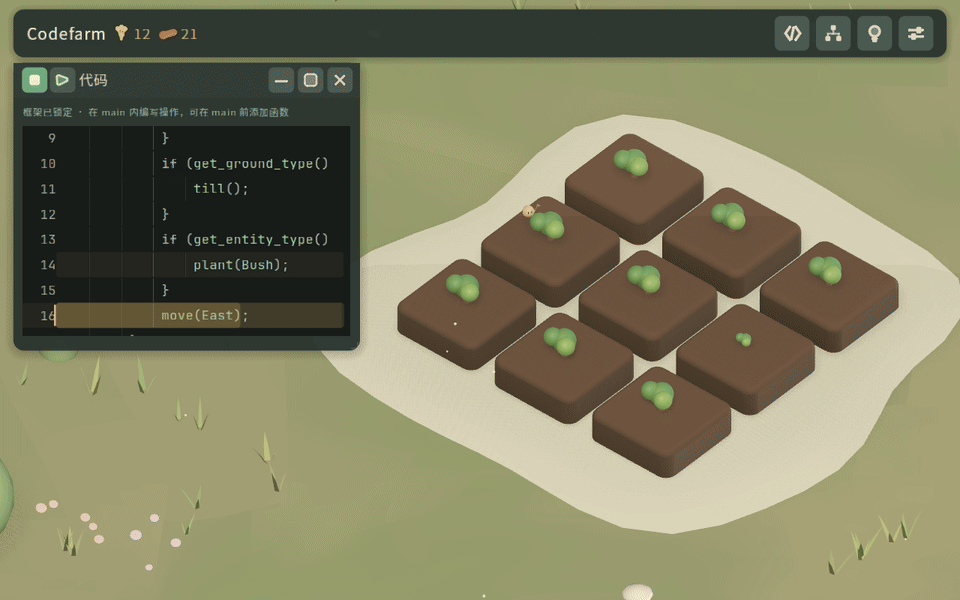
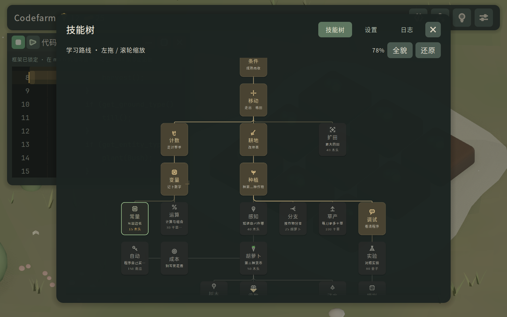
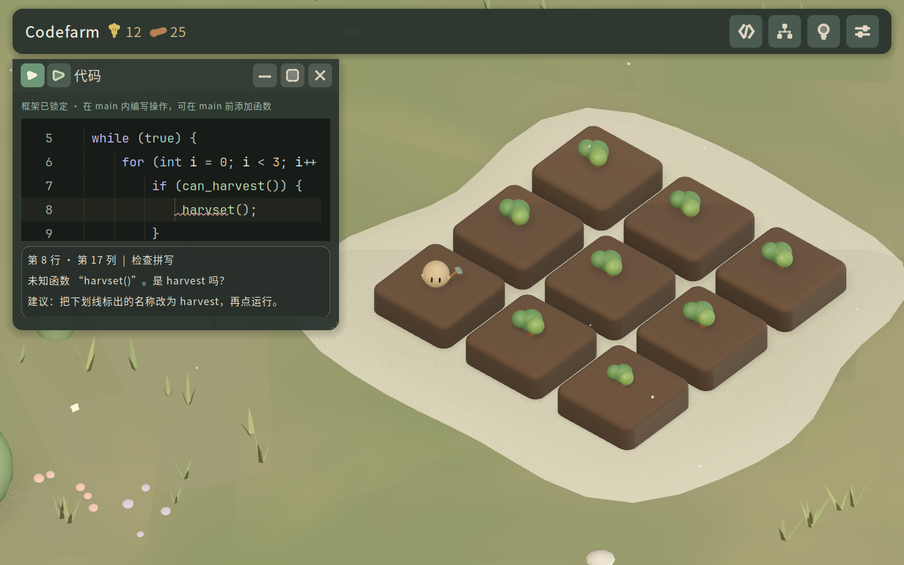
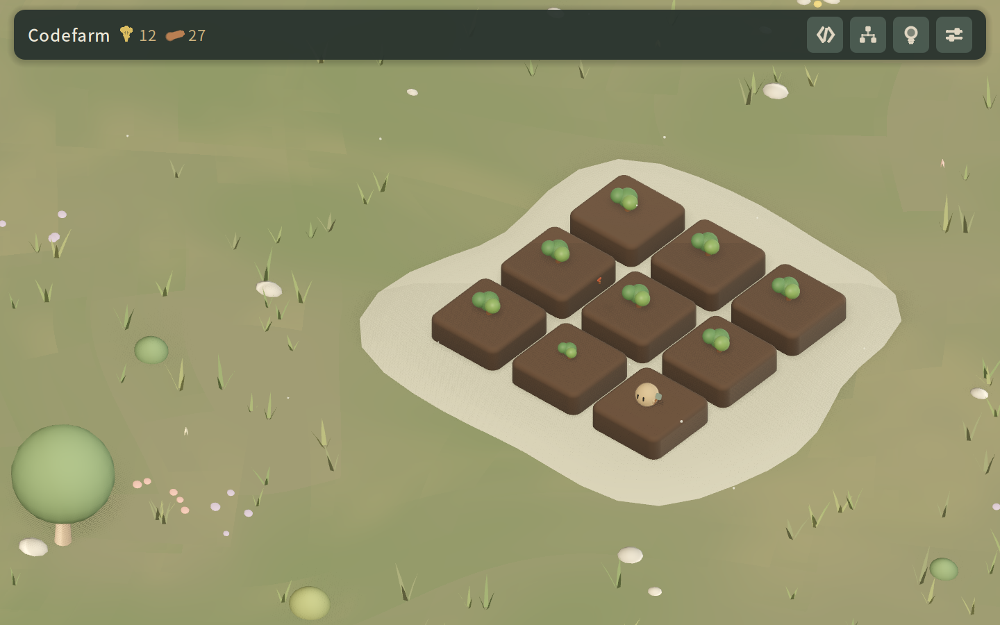
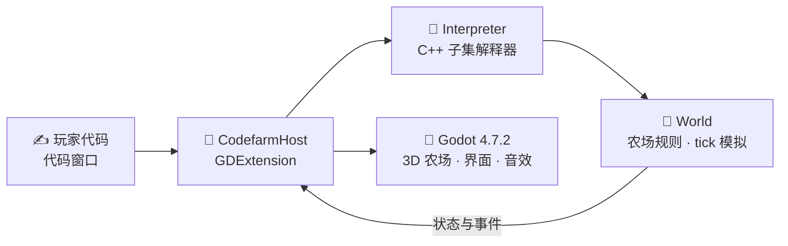

<div align="center">



<br>

[](https://github.com/chang814/codefarm/releases/latest)
[](CHANGELOG.md)
[](LICENSE)

[](https://godotengine.org/)
[](sim/)
[](tests/)
[](docs/skill-tree-design.md)
[](#-致敬原作与许可)

**[🎮 马上试玩](#-马上试玩)** · **[🌾 怎么玩](#-先痛后药一局是怎么展开的)** · **[🛠 构建](#-从源码构建)** · **[📜 致谢](#-致敬原作与许可)** · **[💬 反馈](https://github.com/chang814/codefarm/issues)**

</div>

<br>

<div align="center">

<br>
<sub><i>代码一行一行地跑，当前行高亮，小 bot 跟着动。</i></sub>
</div>

<br>

> [!NOTE]
> **Codefarm 是一部致敬作品。** 它的核心玩法——用代码指挥无人机种田、逐步解锁编程概念——源自 **Timon Herzog** 开发的
> [**《The Farmer Was Replaced》**](https://store.steampowered.com/app/2060160/The_Farmer_Was_Replaced/)。
> 如果你喜欢这种玩法，请支持原作。本项目是非官方的学习型作品，与原作者及发行方无关，
> 不包含任何原作的代码、美术、音乐或商标素材。详见 [致敬原作与许可](#-致敬原作与许可)。

## ✨ 这是什么

你只有一块草地、一只奶黄色的小 bot，和一个代码窗口。第一行程序只有 `harvest();`——点一下运行，它收一刀。

很快你会嫌它太慢，于是学会 `while`；加速之后它开始乱砍没长熟的草，于是学会 `if`；田变大了，手抄 `move` 太累，于是学会 `for`、变量、函数、数组、结构体……直到你写出一套**指挥好几架无人机同时干活的自动化农场**。

和原作用 Python 风格语言不同，Codefarm 里写的是**标准 C++ 程序形态**：`#include <bits/stdc++.h>`、`using namespace std;`、`int main()`。适合正在学 C++ 的同学，把课本上的语法真正“用起来”。

<table>
<tr>
<td width="33%" align="center" valign="top">
<h3>🧑‍💻</h3>
<b>真正的 C++</b><br>
<sub>标准程序框架，教学用 C++ 子集解释器，语法随技能逐步解锁。</sub>
</td>
<td width="33%" align="center" valign="top">
<h3>💊</h3>
<b>先痛后药</b><br>
<sub>每个新概念都先让你撞上一个具体麻烦，再交给你刚好能治它的写法。</sub>
</td>
<td width="33%" align="center" valign="top">
<h3>🎯</h3>
<b>规则可复现</b><br>
<sub>按 tick 精确模拟；同样的程序、同样的种子，结果一模一样。</sub>
</td>
</tr>
<tr>
<td width="33%" align="center" valign="top">
<h3>🩹</h3>
<b>对新手友好</b><br>
<sub>默认框架受保护；报错标出行列、波浪线，并给一句修改建议。</sub>
</td>
<td width="33%" align="center" valign="top">
<h3>💾</h3>
<b>自动存档</b><br>
<sub>农场、背包、技能、代码随时保存，带校验与备份，关掉再开接着玩。</sub>
</td>
<td width="33%" align="center" valign="top">
<h3>🎨</h3>
<b>全部程序化</b><br>
<sub>小 bot、地块、草甸、蝴蝶和音效都由代码生成，没有一张外部贴图。</sub>
</td>
</tr>
</table>

## 🎮 马上试玩

<table>
<tr>
<td align="center" width="33%"><h2>①</h2>打开 <a href="https://github.com/chang814/codefarm/releases/latest"><b>Releases 下载页</b></a><br>下载 <code>Codefarm-v0.2.11-Windows-x64.zip</code></td>
<td align="center" width="33%"><h2>②</h2><b>完整解压</b><br>双击 <code>Codefarm.exe</code><br><sub>（或 <code>开始游戏.cmd</code>）</sub></td>
<td align="center" width="33%"><h2>③</h2>点「开始游戏」<br>在代码窗口里点 <b>▶</b><br>运行第一段程序</td>
</tr>
</table>

> [!TIP]
> 不需要安装 Godot，也不需要 C++ 编译器。不要下载 GitHub 自动生成的 *Source code* 压缩包——那是源码，不是游戏。需要 Windows x64 和支持 Vulkan 的显卡，目前没有网页版和手机版。

## 🌾 先痛后药：一局是怎么展开的

<table>
<tr><th width="40%">😣 你遇到的麻烦</th><th>💡 你学会的写法</th></tr>
<tr><td>每点一次运行，bot 只收一刀</td><td>

```cpp
while (true) {
    harvest();
}
```

</td></tr>
<tr><td>买了「加速」，bot 开始砍没长熟的草，草一直长不大</td><td>

```cpp
while (true) {
    if (can_harvest()) {
        harvest();
    }
}
```

</td></tr>
<tr><td>田变成 3×3，同一句 <code>move</code> 要抄好多遍</td><td>

```cpp
for (int i = 0; i < 3; i++) {
    if (can_harvest()) harvest();
    move(East);
}
move(North);
```

</td></tr>
<tr><td>照料一格的代码越写越长，全挤在 <code>main</code> 里</td><td>

```cpp
void tendTile() { /* 收割、翻土、种树、浇水… */ }
```

</td></tr>
<tr><td>一架无人机绕一圈太慢</td><td>

```cpp
spawn_drone(farmForever);
```

</td></tr>
</table>

<details>
<summary><b>🌳 展开完整的 39 个技能路线</b></summary>
<br>

| 阶段 | 解锁内容 |
| --- | --- |
| 🌱 起步 | 收获 → 循环 → 加速 → 条件 → 移动 |
| 🧭 走遍整块田 | 计数 `for`、变量、常量、运算、感知坐标、分支 `switch`、扩田 |
| 🥕 更多作物 | 耕地、种植、胡萝卜、浇水、树木、向日葵、南瓜、仙人掌 |
| 🧩 组织代码 | 函数、引用 `int&`、分文件 `#include`、数组、结构体、工具函数 |
| 🧪 观察与实验 | 调试输出、计时 `get_time()`、实验田、可复现的 `simulate()` |
| 🚀 后期玩法 | 肥料与迷宫、伴生作物、恐龙帽、自动解锁 `unlock()`、多无人机 |

每个技能都附带一份**范本**，解锁后可以展开、复制或一键载入。范本和自动通关测试读的是同一份文件，所以一定能跑通。

</details>

## 📸 截图

<table>
<tr>
<td width="50%"></td>
<td width="50%"></td>
</tr>
<tr>
<td align="center"><sub>🌳 可拖动、可缩放的技能树，金色为已解锁</sub></td>
<td align="center"><sub>🩹 写错了也没关系：行列、波浪线、修改建议</sub></td>
</tr>
<tr>
<td width="50%"></td>
<td width="50%"></td>
</tr>
<tr>
<td align="center"><sub>🚜 单步或整段运行，当前行实时高亮</sub></td>
<td align="center"><sub>🦋 云影、摆动的草、花丛与蝴蝶，全部程序化生成</sub></td>
</tr>
</table>

## 🕹 操作

| 操作 | 方法 |
| --- | --- |
| ▶ 运行整个 `main` / ▷ 单步 | 代码窗口的实心 / 空心三角 |
| ⏹ 停止程序 | 再点一次运行按钮，或点进代码区 |
| 🖐 平移农场 / 技能树 | 按住左键拖动 |
| 🔄 转动视角 / 🔍 缩放 | 右键拖动 / 滚轮 |
| ⌨ 移动视角 / 回正 | WASD / F |
| 🔠 代码字号 | Shift + 滚轮，Ctrl + 0 复位 |

> [!IMPORTANT]
> 存档在 `%APPDATA%\Godot\app_userdata\Codefarm\progress.json`，同目录还有一份 `.bak` 备份。更换版本前顺手备份这两个文件。

## 🛠 从源码构建

需要 **CMake 3.17+**、**Ninja**、支持 **C++20** 的编译器（Windows 推荐 MinGW-w64），运行游戏还需要 **Godot 4.7.2**。仓库已包含 `third_party/godot-cpp`。

<details>
<summary><b>🧪 只编译模拟器和测试（不需要 Godot）</b></summary>

```sh
cmake -S . -B build-tests -G Ninja -DCODEFARM_BUILD_EXTENSION=OFF
cmake --build build-tests
ctest --test-dir build-tests --output-on-failure
```

想看完整的玩家通关路线和每一档用时，运行 `build-tests/codefarm_playthrough`。

</details>

<details>
<summary><b>🎮 构建 Godot 扩展并打开游戏</b></summary>

```sh
cmake -S . -B build -G Ninja -DCODEFARM_BUILD_EXTENSION=ON
cmake --build build
```

生成的库会放进 `game/bin`。Windows 的 MinGW 构建还需要 `libgcc_s_seh-1.dll`、`libstdc++-6.dll`、`libwinpthread-1.dll` 能被系统找到（放进 `game/bin` 即可）。

然后用 Godot 4.7.2 打开 `game/project.godot`，主场景是 `scenes/main.tscn`。扩展更新后要完全退出 Godot 再重新打开。

</details>

<details>
<summary><b>✅ Godot 端验收脚本</b></summary>

```sh
godot --headless --path game --script scripts/verify_headless.gd   # VERIFY_OK
godot --path game --script scripts/verify_smoke.gd                 # SMOKE_OK
godot --path game --script scripts/verify_save.gd                  # SAVE_OK
```

所有验收脚本都使用独立的测试存档，不会碰你的游戏进度。

</details>

## 🧱 项目结构



逻辑和画面完全分开：`sim/` 里的纯 C++ 模拟器决定一切规则，Godot 只负责把结果画出来，动画不会改变判定。

| 目录 | 内容 |
| --- | --- |
| 📐 `sim/` | 世界规则与解释器，纯 C++，不依赖 Godot |
| 🔌 `extension/` | 把模拟器接进 Godot 的 GDExtension |
| 🎨 `game/` | Godot 工程：界面、3D 农场、程序化场景与音效 |
| 📗 `game/exemplars/` | 每个技能的范本，游戏与通关测试共用 |
| 🧪 `tests/` | 单元测试，以及从新存档打到最后的整局通关测试 |
| 📚 `docs/` | 课程设计、技能树、通关记录与检查报告 |

## ✅ 质量

- **1844 项** C++ 自动检查全部通过，其中包括**整局通关测试**：从全新存档出发，只用玩家能做的操作（攒资源、买技能、运行范本），完成全部 **45 次购买**，约 **52 分钟**游戏时间。
- 每个技能节点都有能解析、能运行的范本。
- Godot 端在真实 Vulkan 渲染下跑冒烟、界面动效、技能树拖动、编辑器、存档等多项自动验收。

## 🗺 路线图

- [x] 主线 39 个技能与全部作物
- [x] 自动存档、欢迎页、音效、程序化草甸
- [ ] 主线通关后的无尽 / 优化挑战（按 tick、代码量打分，见 [设计草案](docs/endless-design.md)）
- [ ] 迷宫长时间挂机的稳定求解
- [ ] 更多硬件上的兼容性验证与更小的导出包

欢迎在 [Issues](https://github.com/chang814/codefarm/issues) 里反馈：写清版本号、操作步骤，最好附一张截图。⭐ 如果你喜欢，给个 Star 吧！

## 📜 致敬原作与许可

**原作。** Codefarm 的玩法灵感来自 [**《The Farmer Was Replaced》**](https://store.steampowered.com/app/2060160/The_Farmer_Was_Replaced/)，由 **Timon Herzog** 开发，Metaroot 与 Timon Herzog 发行。“用代码自动化农场、按技能树逐步解锁编程概念”这一核心创意属于原作者。

**本项目的边界。** Codefarm 是非官方的、以学习 C++ 为目的的同人式作品，与原作者及发行方没有任何关联，也未获得其背书。本仓库**不包含**原作的任何代码、美术、音乐、文本或商标素材：所有代码、3D 造型、图标与音效均为本项目原创，由作者与 AI 协作完成。《The Farmer Was Replaced》及相关名称、商标归其各自权利人所有。如权利人认为本项目有任何不妥，请通过 [Issues](https://github.com/chang814/codefarm/issues) 联系，我们会及时处理。

**许可。** Codefarm 自身的源码以 [MIT 许可](LICENSE) 开源。第三方组件保留各自的许可：[Godot Engine](https://godotengine.org/) 与 [godot-cpp](https://github.com/godotengine/godot-cpp)（MIT）、[Noto Sans CJK](https://github.com/notofonts/noto-cjk) 与 [JetBrains Mono](https://www.jetbrains.com/lp/mono/)（SIL OFL 1.1）、Droid Sans Fallback（Apache 2.0）、MinGW 运行库（GPL + GCC Runtime Library Exception）。完整文本见 [`licenses/`](licenses/)。

<br>

<div align="center">

**用一行 `harvest();` 开始。** 🌾

<sub>Made with 🌱 C++ · Godot · a lot of grass</sub>

</div>
