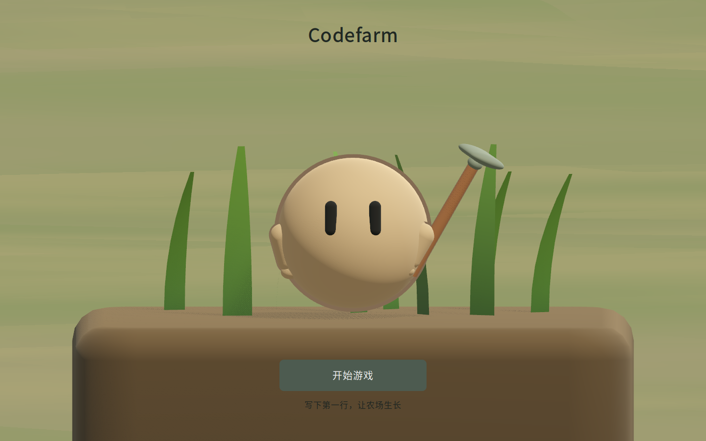
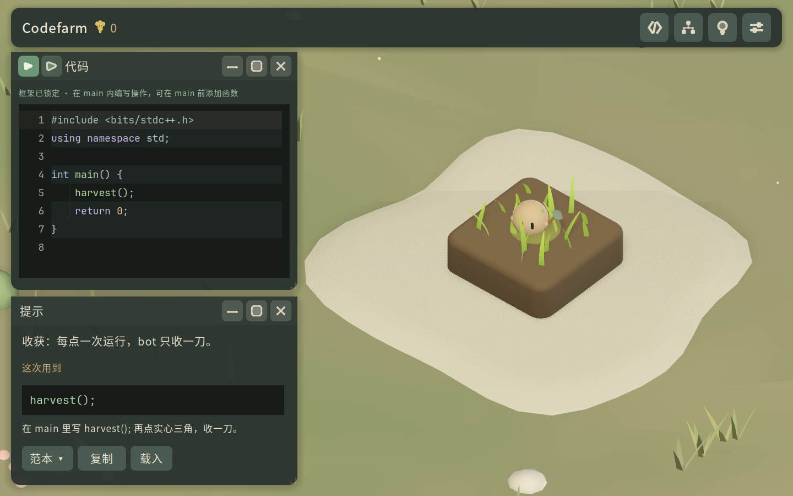

# Codefarm 0.2.11

**用 C++ 写代码，让小 bot 帮你种田。**

一个中文 3D 编程农场游戏：从一次 `harvest()` 开始，用循环、条件、函数、数组和多机协作，把手动农场变成自己的自动化系统。C++ 模拟器负责规则，Godot 4.7.2 呈现柔和的农场与交互。

**[下载 Windows 免安装试玩版](https://github.com/chang814/codefarm/releases/latest)** · [反馈问题](https://github.com/chang814/codefarm/issues) · [更新日志](CHANGELOG.md)



## 马上试玩

1. 打开上方下载页，下载 `Codefarm-v0.2.11-Windows-x64.zip`，不要选择 GitHub 自动生成的 Source code。
2. 完整解压，双击 `Codefarm.exe` 或 `开始游戏.cmd`。无需另外安装 Godot、C++ 编译器。
3. 点击「开始游戏」，在代码窗口里运行第一段程序。

当前试玩包支持 **Windows x64**，推荐支持 Vulkan 的独立显卡或较新的集成显卡。它包含官方 Godot 运行程序和独立资源包，体积比正式导出模板打包偏大。当前没有网页试玩或手机安装包；QQ、微信群里分享的是仓库和下载页面。

## 你会玩到什么

- **先遇到问题，再学新写法**：一刀一刀收太慢，学循环；加速后盲收会打断幼苗生长，学条件判断；田变大，学遍历与函数。
- **C++ 形态的程序**：`#include <bits/stdc++.h>`、`using namespace std;`、`int main()`。这是教学用 C++ 子集解释器，并非完整 C++ 编译器。
- **一棵循序解锁的技能树**：作物、浇水、向日葵、南瓜、迷宫、仙人掌、恐龙帽、多无人机。范本和通关测试读取同一份代码。
- **柔和的交互**：圆角图标、平滑窗口动效、左键拖动和缩放技能树、受保护的默认代码框架、带定位与修正建议的错误提示。
- **自动保存**：进度、背包、技能、代码、设置随时继续；包含校验与备份恢复。
- **原创程序化画面与声音**：小 bot、草甸、花丛、树木、云影、蝴蝶与动作音效。



## 基本操作

| 操作 | 方法 |
| --- | --- |
| 执行整个 main / 单步 | 代码窗口实心三角 / 空心三角 |
| 停止程序 | 再点运行按钮，或点进编辑区 |
| 拖动农场 / 技能树 | 按住鼠标左键拖动 |
| 技能节点 | 轻点解锁或查看详情；拖动不会误购 |
| 转动视角 / 缩放 | 右键拖动 / 滚轮 |
| 回正视角 | F，或设置中的回正入口 |
| 代码字号 | Shift + 滚轮；Ctrl + 0 复位 |

存档位置：`%APPDATA%\Godot\app_userdata\Codefarm\progress.json`。备份为同目录 `.bak` 文件。更换试玩包前可自行保留这两份文件。

## 从源码构建

仓库包含 `third_party/godot-cpp` 源码。Godot 编辑器、编译结果和用户存档不放入 Git；试玩运行程序在 Releases 单独下载。

需要 CMake 3.17+、Ninja、支持 C++20 的编译器；运行游戏还需要 **Godot 4.7.2**。Windows 推荐 MinGW-w64。

### 只编译模拟器和测试

```sh
cmake -S . -B build-tests -G Ninja -DCODEFARM_BUILD_EXTENSION=OFF
cmake --build build-tests
ctest --test-dir build-tests --output-on-failure
```

完整玩家路线：Linux 运行 `./build-tests/codefarm_playthrough`，Windows 运行 `build-tests/codefarm_playthrough.exe`。

### 构建 Godot 扩展

```sh
cmake -S . -B build -G Ninja -DCODEFARM_BUILD_EXTENSION=ON
cmake --build build
```

生成的库位于 `game/bin`。Windows MinGW 构建还需要让 `libgcc_s_seh-1.dll`、`libstdc++-6.dll` 和 `libwinpthread-1.dll` 可被系统加载。用 Godot 打开 `game/project.godot`，主场景是 `scenes/main.tscn`。扩展更新后需退出并重新打开 Godot。

`game/export_presets.cfg` 提供 Windows 资源包导出预设；当前 Release 使用资源包与官方 Godot 程序组合。

## 目录与开发说明

| 目录 | 内容 |
| --- | --- |
| `sim/` | 纯 C++ 世界规则与解释器，无 Godot 依赖 |
| `extension/` | GDExtension 桥接 |
| `game/` | Godot 工程、UI、音效与程序化场景 |
| `game/exemplars/` | 游戏和通关测试共用的范本 |
| `tests/` | 单元测试与完整玩家路线 |
| `docs/` | 课程、设计与检查记录 |
| `licenses/` | 随包第三方许可 |

本次发布复核：C++ 1844 项检查通过；存档专项 `SAVE_OK`、真实 Vulkan 界面专项 `REFINE_0210_OK`。试玩包额外核对字体、范本读取与收割。自动化通关通过不代表所有种子和长期运行场景均已覆盖。

仍在开发：DLC 作物与无尽挑战尚未实现；长时间迷宫求解、教学节奏和更多硬件兼容性仍需继续优化。欢迎提交操作步骤、截图和版本号反馈。

原创代码、美术和机制由作者与 AI 协作开发；不分发参考作品的贴图、音乐或商标资源。第三方 Godot、godot-cpp、字体与运行库保留各自许可，见 `licenses/` 与 `third_party/godot-cpp/LICENSE.md`。
